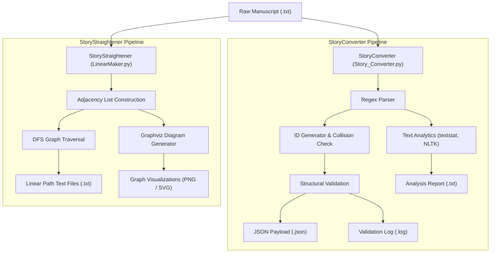

# Branching Realms Backend Pipeline

A dual-utility Python automation suite that converts unstructured branching narrative manuscripts into validated JSON payloads and flattens decision graphs into linear text paths.

## PART 1: Overview

### The Business Case
Game writing workflows frequently produce raw text documents with manual node numbering and choice targets. Ingesting these files into an interactive game engine manually causes broken links, orphaned passages, and missing content. This repository automates the conversion, graph validation, and serialization pipeline, eliminating manual data entry while catching syntax and traversal errors before game assets reach production.

### Tech Stack
* Python 3.11
* Tkinter (Desktop GUI)
* PyInstaller (Windows binary compilation)
* NLTK & WordNet (Text tokenization and synonym expansion)
* textstat (Flesch-Kincaid readability scoring)
* better_profanity (Wordlist-based string checking)
* Graphviz (Directed graph visualization to PNG and SVG)
* Standard Library: `re`, `json`, `threading`, `pathlib`, `random`, `string`

---

## PART 2: Architecture & Logic

### Data Flow



### Core Logic & Fault Tolerance

The codebase handles data integrity and operational edge cases through specific checks:

* **ID Collision Prevention:** `Story_Converter.py` enforces global uniqueness across game sections by persisting generated IDs in `used_section_ids.txt`. For each section, the generator zero-pads the base number to three digits, appends a four-character uppercase alphanumeric suffix, and checks the candidate against an in-memory set loaded from disk. It runs inside a `while True` loop until an unassigned ID is verified, preventing overwrite collisions across separate import runs.
* **Referential Integrity & Graph Validation:** During JSON conversion, `validate_story_json()` performs three graph audits:
  * *Broken Links:* Iterates over all section choices and flags any target whose `nextSectionId` does not exist in the mapped section register.
  * *Unreachable Nodes:* Calculates the difference between the full node set and the union of all incoming edges plus the root node (`001`), logging orphaned passages.
  * *Content Loss:* Compares word counts between raw text blocks and parsed text fields. If the count differs by more than three words, it logs a warning in `story_validation.log`.
* **Cycle Handling in Graph Traversal:** In `LinearMaker.py`, the Depth-First Search (`dfs`) function builds paths from node `1` to terminal ending nodes. To prevent infinite recursion caused by narrative loops or circular references, the traversal verifies `if next_sec not in path` before traversing down an edge.
* **Dependency Isolation & Early Exit:** `Story_Converter.py` runs with bundled local NLTK data to operate without an active internet connection. On script initialization, it runs a test sentence through `sent_tokenize`. If the tokenizer files are missing or unreadable, a basic `try/except LookupError` catches the failure, writes a traceback to the console, and halts execution immediately rather than failing mid-process.
* **Threaded Execution & UI Stability:** Both utilities execute file I/O, parsing, and rendering inside separate daemon threads (`threading.Thread`). Standard `try/except Exception` blocks wrap the background logic, routing error messages to Tkinter `messagebox.showerror` popups so unexpected file formatting errors notify the user without locking the UI process.

### Deployment & Execution

The tools operate as local desktop utilities and do not require external network services:
* **Standalone Binaries:** Compiled for Windows into portable `.exe` files (`Story_Converter.exe` and `LinearMaker.exe`) using PyInstaller. Custom hook scripts (`hook-better_profanity.py`, `hook-cmudict.py`) force the inclusion of non-code data files into the `_internal/` distribution directory.
* **Direct Script Execution:** The tools can be run directly through the Python interpreter:
  ```powershell
  python StoryConverter/Story_Converter.py
  python StoryStraightener/LinearMaker.py
  ```

